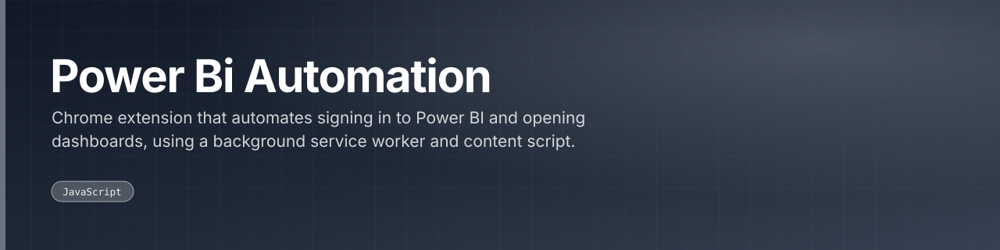

Chrome extension that automates signing in to Power BI and opening dashboards, using a background service worker and content script.

 

 

---

## What this is

A Chrome extension that removes the manual sign-in step when opening Power BI dashboards. An `autologin` script fills the credentials flow, driven from a background service worker and a content script injected into the page.

|  |
|:--:|
| **1** |
| docs |

---

<a href="https://github.com/gowtham-creator/Power-Bi-automation">gowtham-creator/Power-Bi-automation</a>

